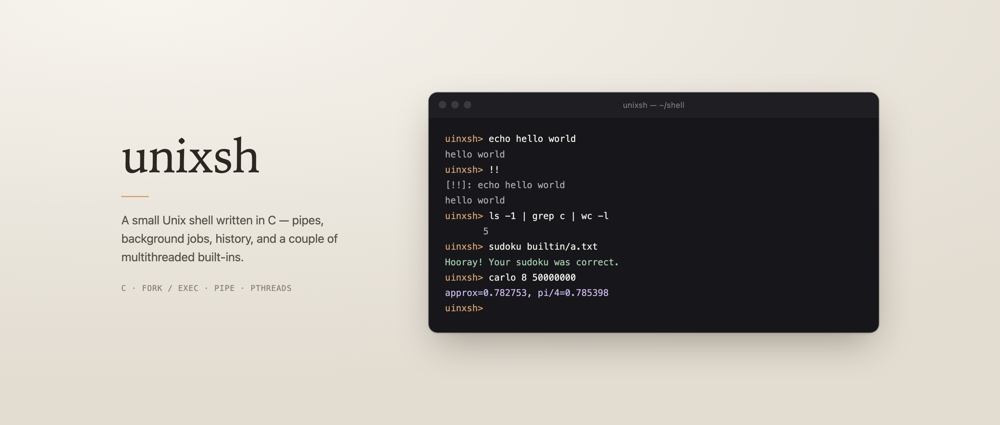
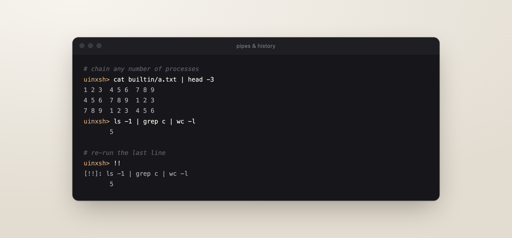
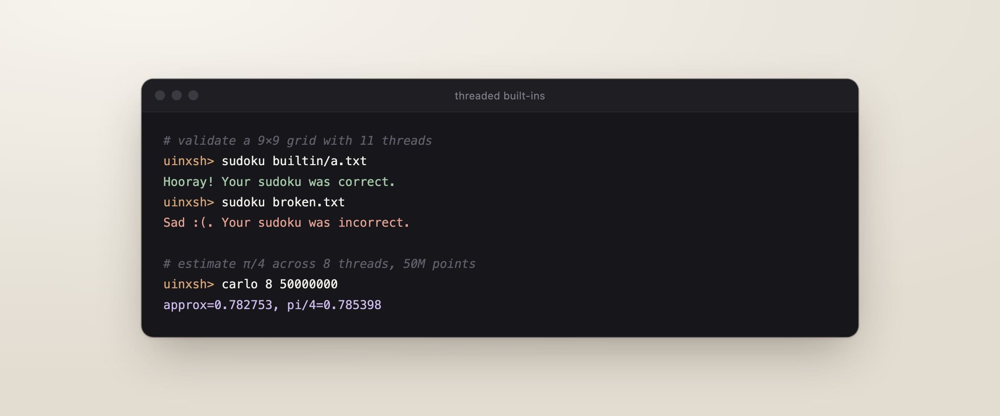
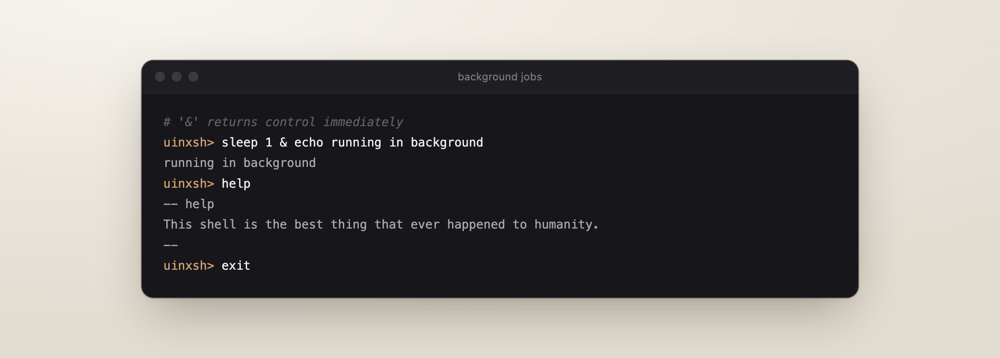

<p align="center">
  
</p>

<p align="center">
  <sub>A compact, readable shell for learning how processes, pipes and threads fit together.</sub>
</p>

---

## Overview

`unixsh` is a minimal interactive shell built directly on POSIX primitives —
`fork`, `execvp`, `pipe`, `dup2` and `waitpid`. It is around 500 lines of C,
split into small files that each do one thing, so the whole program can be
read in a single sitting.

It also ships two built-ins that use **pthreads**: a parallel Sudoku validator
and a Monte Carlo estimator for π.

## Features

- **Pipelines** — chain any number of commands with `|`
- **Background jobs** — run commands with `&` without waiting for them
- **History** — repeat the previous line with `!!`
- **Line editing** — arrow keys and in-line editing through Readline
- **Built-ins** — `help`, `pwd`, `cd`, `sudoku`, `carlo`, `exit`

## Getting started

You need a C compiler and the Readline library (on macOS, the system's
`libedit` provides it).

```bash
make compile
```

```bash
./unixsh
```

`make dev` builds and launches in one step.

## A closer look

### Pipes & history

Each stage of a pipeline is forked into its own process, with `stdout` of one
stage wired to `stdin` of the next. `!!` recalls and re-runs the last line.

<p align="center">
  
</p>

### Threaded built-ins

**`sudoku <file>`** reads a 9×9 grid and checks it with eleven threads —
one for all rows, one for all columns, and one for each 3×3 box.
[`builtin/a.txt`](builtin/a.txt) is a valid example.

**`carlo [threads] [points]`** estimates π/4 by sampling random points in a
square and counting how many land inside the unit circle, splitting the work
across threads. Defaults are 5 threads and 100,000,000 points.

<p align="center">
  
</p>

### Background jobs

A trailing `&` starts a command without waiting on it, so the shell moves
straight on to the next one.

<p align="center">
  
</p>

## How it works

```text
main.c            read a line, expand !!, record history, dispatch
input.c           split the line on '&', then on '|', then on spaces
exec.c            fork each pipeline stage, connect pipes, wait or detach
history.c         a growable array of previous lines
builtin/
  builtin.c       built-in lookup table: cd, pwd, help, sudoku, carlo
  sudoku.c        11-thread Sudoku validator
  carlo.c         multithreaded Monte Carlo estimate of π
```

A line goes through three stages:

1. **Parse** — split on `&` into jobs, each job on `|` into stages, each stage
   on whitespace into `argv`.
2. **Execute** — for each stage, `fork`; in the child, `dup2` the pipe ends
   onto `stdin`/`stdout`, then run a built-in or `execvp`.
3. **Wait** — foreground jobs are reaped with `waitpid`; background jobs are
   left to run.

## Limitations

This is a teaching-sized shell, and it keeps things simple on purpose:

- No quoting, escaping, globbing, or variable expansion — arguments are split
  on spaces only.
- No I/O redirection (`<`, `>`).
- Built-ins run in a forked child, so `cd` does not change the shell's own
  working directory.
- Background jobs are not tracked; there is no `jobs`, `fg` or `bg`.
